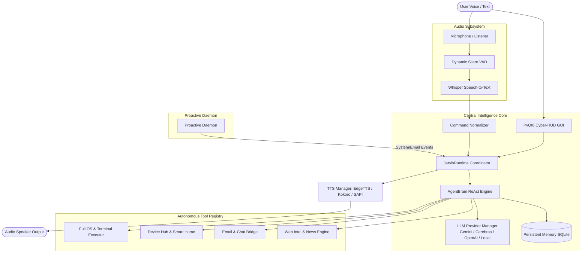

# JARVIS AUTONOMOUS AI ASSISTANT: MASTER ARCHITECTURE & A-TO-Z USER GUIDE

---

## 1. Executive Summary & Overview

**Jarvis** is a state-of-the-art, autonomous, multi-device, and voice-driven desktop AI assistant. Upgraded from a reactive script into a full **ReAct Reasoning Agent**, Jarvis bridges local operating system control, live internet intelligence, smart home automation, email and chat communications, persistent long-term memory, and proactive background monitoring.

### Core Capabilities Matrix
- **Agentic Reasoning (ReAct Loop)**: Dynamic tool calling, step-by-step reasoning, self-correction, and autonomous decision making.
- **Persistent Long-Term Memory & Auto-Learning**: Automatically learns user habits, profile facts, and preferences across sessions using SQLite database storage.
- **Real-Time Web & News Intelligence**: Zero-API-key live web search, breaking RSS news aggregation, live weather forecasts, and automated morning briefings.
- **Email & Communication Suite**: Unread email fetching, message drafting, SMTP dispatch, and remote Telegram / WhatsApp bridging.
- **Multi-Device & Smart Home Control**: Home Assistant REST API for IoT devices (lights, AC, smart plugs), Android ADB device control, and phone pinging.
- **Proactive Background Daemon**: Proactively monitors battery health, system load, calendar reminders, and urgent emails without requiring a wake-word trigger.
- **Ultra-Low Latency Speech Engine**: OpenWakeWord / Porcupine wake detection, Silero VAD, OpenAI Whisper speech-to-text, and multi-tier TTS (EdgeTTS, Kokoro, Windows SAPI5).
- **Cyber-HUD Dashboard**: PyQt6 dark glassmorphic GUI with real-time audio visualizer, conversation chat stream, telemetry dials, and quick action docks.

---

## 2. Master System Architecture



---

## 3. The 6 Architectural Pillars

### Pillar 1: Autonomous Agent Brain & Tool Calling (`core/ai/agent_brain.py`)
- **Pattern**: ReAct (Reasoning + Acting) execution loop.
- **Mechanism**: The Agent receives user input, inspects long-term memory, selects appropriate tools from the tool registry, executes them, feeds observations back into the neural reasoner, and synthesizes crisp, spoken answers.
- **Fallback Chain**: Fast-path pattern routing (0ms) -> Gemini 2.0 Flash -> Cerebras Fast Inference -> OpenAI / Groq -> Local Deterministic Engine.

### Pillar 2: Email & Communication Suite (`modules/communication/`)
- **`email_service.py`**:
  - Secure IMAP/SMTP connectivity for Gmail, Outlook, Yahoo, and corporate mail.
  - Automatically fetches unread messages, extracts sender/subject/body snippets, and drafts intelligent replies.
  - Built-in simulation fallback for instant testing without mandatory email credentials.
- **`chat_bridge.py`**:
  - Telegram Bot API integration for sending remote alerts or receiving remote commands.
  - WhatsApp web deep-linking and push webhook dispatch.

### Pillar 3: Real-Time Web Intelligence & News (`modules/web/web_intel.py`)
- **Live Search**: Instant answers and search result snippets via DuckDuckGo endpoints without paid API subscriptions.
- **RSS News Aggregator**: Real-time breaking headlines from BBC World, TechCrunch, BBC Business, and Science RSS feeds.
- **Live Weather**: Instant temperature, wind speed, precipitation, and condition metrics via `wttr.in` JSON API.
- **Daily Morning Briefing**: Combines live weather, top world headlines, and system status into an executive morning update ("Jarvis, give me my morning briefing").

### Pillar 4: Multi-Device Ecosystem & Smart Home (`modules/devices/device_hub.py`)
- **Home Assistant**: REST API client for switching lights, activating scenes, toggling switches, and adjusting climate.
- **Android ADB Bridge**: Pings mobile phone, triggers audio chimes, checks remote phone battery percentage, and triggers Android alarms.
- **Local Network Discovery**: Health check pinging across connected devices on the local LAN.

### Pillar 5: Persistent Long-Term Memory & Auto-Learning (`memory/persistent_memory.py`)
- **SQLite Database**: Stored at `memory/jarvis_memory.db`.
- **User Profile Store**: Remembers your name, preferences, favorite apps, custom locations, and communication tone.
- **Episodic Memory**: Logs conversational history and semantic interactions.
- **Autonomous Fact Extraction**: Detects natural language statements (e.g., *"Remember that I prefer morning meetings"* or *"My favorite beverage is espresso"*) and saves them automatically into your profile.
- **System Prompt Injection**: Automatically injects relevant user facts into LLM reasoning queries.

### Pillar 6: Proactive Background Daemon (`core/proactive_daemon.py`)
- **Background Observer Thread**: Runs continuously in the background without blocking the main event loop.
- **Battery Sentinel**: Warns when laptop battery drops below 15% while disconnected from power.
- **Inbox Scanner**: Scans for new urgent emails every 5 minutes and posts notifications.
- **Autonomous Speech Alerts**: Speaks urgent alerts directly or posts UI toast notices.

---

## 4. Audio & Voice Pipeline Optimization

### Issues Resolved:
1. **Wake Word 10-Second Deadlock Fixed**:
   - Refactored `SpeechListener` in `core/listener.py`. Wake word triggers dynamic speech capture with a clean 1.2s silence cut-off after speaking, eliminating the prior 10-second stall.
2. **Duplex Audio State Lockout Resolved**:
   - Audio input automatically suspends during TTS playback to prevent acoustic feedback loops, then seamlessly resumes standby monitoring immediately upon speech termination.

---

## 5. User Interface (Cyber-HUD Dashboard)

The PyQt6 dashboard (`ui/main_window.py`) has been redesigned as a cyber glassmorphic control center:
- **Header Bar**: Live status emblem (`STANDBY`, `LISTENING`, `THINKING`, `SPEAKING`, `EXECUTING`), Wake trigger button, and Mic Mute toggle.
- **Audio Visualizer**: Animated multi-frequency glowing soundwave responding dynamically to voice activity.
- **Live Conversation & Agent Trace View**: Rich chat bubbles separating User inputs, Jarvis responses, and colored Tool Execution Badges (`[Tool: Live News]`, `[Tool: Web Search]`, `[OS Action]`).
- **Telemetry & Quick Action Dock**: Real-time CPU and RAM progress bars, plus instant action buttons:
  - ☀️ *Morning Briefing*
  - 📰 *Live World News*
  - 📧 *Check Unread Emails*
  - 🌦️ *Local Weather*
  - 📱 *Ping My Phone*
  - 💡 *Smart Home Lights*
- **Command Input Bar**: Fast typed command bar with instantaneous execution.

---

## 6. A-to-Z Command Reference

| Category | Voice / Typed Command | Description / Tool Triggered |
| :--- | :--- | :--- |
| **Intelligence** | *"Give me my morning briefing"* | Combines live weather and breaking headlines. |
| **News** | *"What is the latest world news?"* | Fetches top headlines from BBC RSS. |
| **Tech News** | *"What is the latest tech news?"* | Fetches TechCrunch tech developments. |
| **Weather** | *"What's the weather in Tokyo?"* | Live weather telemetry from `wttr.in`. |
| **Web Search** | *"Search web for quantum computing advances"* | Live web search and summary. |
| **Email** | *"Check my unread emails"* | Summarizes recent unread inbox messages. |
| **Email** | *"Send an email to john@example.com"* | Prepares and dispatches SMTP message. |
| **Chat** | *"Send Telegram message Meeting at 3 PM"* | Dispatches alert via Telegram bot. |
| **Phone** | *"Ping my phone"* / *"Where is my phone?"* | Triggers sound beacon on mobile phone. |
| **Phone** | *"What is my phone battery?"* | Queries Android battery level. |
| **Smart Home** | *"Turn on the living room lights"* | Home Assistant entity toggle. |
| **Memory** | *"Remember that my favorite editor is VS Code"* | Auto-learns preference into database. |
| **Memory** | *"What do you know about me?"* | Recalls stored user profile facts. |
| **OS Control** | *"Open Google Chrome"* / *"Open Notepad"* | Launches applications from registry. |
| **OS Control** | *"Take a screenshot"* | Captures display into `screenshots/`. |
| **OS Control** | *"Set volume to 80"* / *"Mute volume"* | Controls system audio levels. |
| **OS Control** | *"Lock my computer"* | Triggers OS session lock. |

---

## 7. Configuration & Setup Guide

### Environment Variables (`.env`)
```ini
# AI Provider Keys
GEMINI_API_KEY=your_gemini_api_key
CEREBRAS_API_KEY=your_cerebras_api_key
OPENAI_API_KEY=your_openai_api_key

# Communication Credentials (Optional)
EMAIL_ADDRESS=your_email@gmail.com
EMAIL_PASSWORD=your_app_password
EMAIL_IMAP_SERVER=imap.gmail.com
EMAIL_SMTP_SERVER=smtp.gmail.com
TELEGRAM_BOT_TOKEN=your_telegram_bot_token
TELEGRAM_CHAT_ID=your_chat_id

# Smart Home / IoT (Optional)
HOME_ASSISTANT_URL=http://homeassistant.local:8123
HOME_ASSISTANT_TOKEN=your_long_lived_access_token
```

### Launching Jarvis
- **Launch with Cyber-HUD UI (Default)**:
  ```bash
  python main.py
  ```
- **Launch in Headless Voice Core Mode (No GUI)**:
  ```bash
  python main.py --headless
  ```
- **Launch Minimized to System Tray**:
  ```bash
  python main.py --minimized
  ```

---

## 8. Developer Extensibility: Adding Custom Tools

To add a new autonomous tool to Jarvis, register it in `core/ai/agent_brain.py`:

```python
self.tools["your_custom_tool"] = {
    "description": "Clear explanation of what the tool accomplishes and when the LLM should call it.",
    "func": lambda param1, param2="default": your_module.execute(param1, param2)
}
```

The ReAct engine will automatically expose the tool schema to the LLM and handle execution, parameter parsing, observation feedback, and spoken synthesis.
