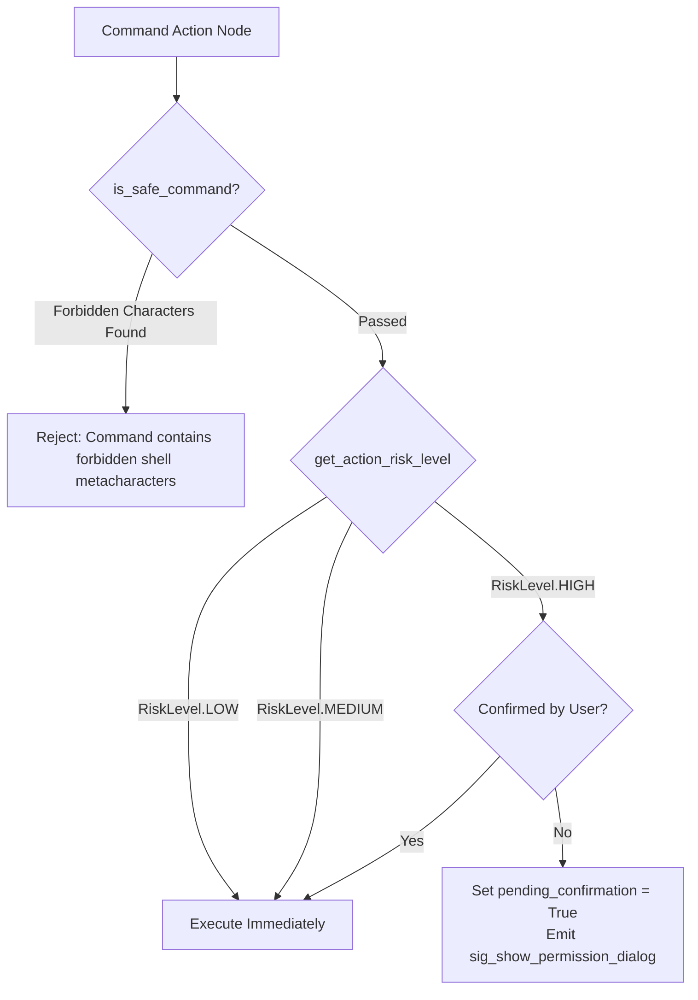

# JARVIS Tool & External API Execution Flow

## 1. Overview & Classification Schema

JARVIS separates operations into four distinct execution categories to guarantee determinism, safety, and transparent tracing:

1. **Local Function Calls [LOCAL]**: Direct in-process Python operations (e.g. date/time queries, local template lookups, math calculations).
2. **Operating System Actions [OS]**: System-level commands interacting with Windows APIs, processes, filesystem, volume, or display.
3. **External API Calls [EXTERNAL_API]**: Remote HTTP/REST/WebSocket connections (e.g. EdgeTTS, Cloud LLMs, web searches).
4. **Tool / MCP Calls [TOOL/MCP]**: Structured tool dispatches executed through `CommandExecutor` or modular capability registries.

---

## 2. Tool & API Routing Graph

```mermaid
graph TD
    subgraph Routing_Decision ["Intent Routing & Gate"]
        CMD["Normalized Command<br/>[core/command_normalizer.py]"] --> IE["IntentEngine.parse()<br/>[core/intent_engine.py]"]
        IE --> INTENT{"Intent Type?"}
    end

    subgraph Local_Actions ["Category 1: Local In-Process Calls [LOCAL]"]
        INTENT -->|time_query| T_ACT["datetime.now().strftime('%I:%M %p')<br/>Duration: <0.5ms"]
        INTENT -->|date_query| D_ACT["datetime.now().strftime('%A, %B %d, %Y')<br/>Duration: <0.5ms"]
        INTENT -->|math_calculation| M_ACT["Python math/regex evaluator<br/>Duration: <1ms"]
        INTENT -->|greeting / help / identity| L_ACT["LocalResponseEngine template lookup<br/>Duration: <1ms"]
    end

    subgraph OS_Actions ["Category 2: Operating System Actions [OS]"]
        INTENT -->|OS Intents| SG["Safety Gate: permissions.py<br/>is_safe_command() & risk_level"]
        SG -->|HIGH Risk & Not Confirmed| PEND["pending_confirmation = True<br/>Prompt User for Confirmation"]
        SG -->|LOW / MEDIUM or Confirmed| EX["CommandExecutor.execute()<br/>[modules/system/executor.py]"]

        EX -->|open_app| APP_ACT["AppControl.open_app()<br/>os.startfile() / subprocess.Popen()"]
        EX -->|close_app| CLS_ACT["AppControl.close_app()<br/>psutil.process_iter() -> p.terminate()"]
        EX -->|volume_up / down / mute| VOL_ACT["SystemControl.volume_*()<br/>pycaw IAudioEndpointVolume"]
        EX -->|screenshot| SCR_ACT["Screenshot.take_screenshot()<br/>PIL.ImageGrab.grab() -> disk save"]
        EX -->|window_control| WIN_ACT["WindowControl.*()<br/>ctypes.windll.user32.ShowWindow()"]
        EX -->|file_access| FIL_ACT["FileControl.open_directory()<br/>os.startfile(folder_path)"]
        EX -->|lock_pc| LCK_ACT["SystemControl.lock_system()<br/>ctypes.windll.user32.LockWorkStation()"]
    end

    subgraph External_APIs ["Category 3: External API Calls [EXTERNAL_API]"]
        INTENT -->|open_website| WEB_ACT["WebControl.open_website()<br/>webbrowser.open(url)"]
        INTENT -->|web_search| SCH_ACT["BrowserManager.search(query)<br/>GET https://www.google.com/search?q=..."]
        INTENT -->|conversation| CM["ConversationManager.process_query()<br/>[core/conversation_manager.py]"]
        
        CM --> PM["ProviderManager.generate_response()<br/>[core/ai/provider_manager.py]"]
        PM -->|ai_provider == 'gemini'| GEM_API["Google Gemini API<br/>POST generativelanguage.googleapis.com"]
        PM -->|ai_provider == 'openrouter'| OPR_API["OpenRouter API<br/>POST openrouter.ai/api/v1/chat/completions"]
        PM -->|ai_provider == 'cerebras'| CER_API["Cerebras Cloud API<br/>POST api.cerebras.ai/v1/chat/completions"]
        PM -->|ai_provider == 'openai'| OAI_API["OpenAI API<br/>POST api.openai.com/v1/chat/completions"]
        PM -->|ai_provider == 'none'| OFF_ACT["Local Fallback Response<br/>'I'm limited to local capabilities'"]
    end

    subgraph TTS_API ["Category 4: TTS Remote Synthesis [EXTERNAL_API]"]
        RESP["ResponseManager<br/>[core/response_manager.py]"] --> TTS["TTSManager.speak()<br/>[core/tts/tts_manager.py]"]
        TTS -->|tts_provider == 'edge'| EDG_API["Microsoft Edge Neural TTS<br/>WSS speech.platform.bing.com/consumer/speech/synthesize/readaloud"]
        TTS -->|tts_provider == 'sapi'| SAP_LOC["Windows SAPI COM [LOCAL/OS]<br/>SpVoice / SpFileStream"]
    end
```

---

## 3. Tool & External Call Inventory

| Operation / Call | Target Module | Call Category | External Endpoint / OS API | Sanitization / Secret Redaction |
|---|---|---|---|---|
| **App Launch** | `modules/system/app_control.py` | `[OS]` | `os.startfile()`, `subprocess.Popen` | Strips shell metacharacters (`&`, `;`, `\|`) |
| **App Termination** | `modules/system/app_control.py` | `[OS]` | `psutil.process_iter()`, Win32 `TerminateProcess` | Process name validated against `applications.json` |
| **Volume Adjustment** | `modules/system/system_control.py` | `[OS]` | `pycaw.pycaw.IAudioEndpointVolume` | Clamped to [0.0, 1.0] range |
| **Screen Capture** | `modules/system/screenshot.py` | `[OS]` | `PIL.ImageGrab.grab()` | Saves to `screenshots/screenshot_*.png` |
| **Workstation Lock** | `modules/system/system_control.py` | `[OS]` | `ctypes.windll.user32.LockWorkStation()` | None |
| **Folder Access** | `modules/files/file_control.py` | `[OS]` | `os.startfile(folder_path)` | Path traversal prevented; allowed directory registry |
| **Web Browser Launch** | `modules/browser/web_control.py` | `[EXTERNAL_API]` | `webbrowser.open(target_url)` | Validated against `links.json` whitelist |
| **Web Search** | `core/os/browser_manager.py` | `[EXTERNAL_API]` | `GET https://www.google.com/search?q={query}` | Query URL-encoded |
| **Edge TTS Synthesis** | `core/tts/providers/edge_tts_provider.py` | `[EXTERNAL_API]` | `wss://speech.platform.bing.com/` | No user auth headers; public Edge endpoint |
| **Windows SAPI COM** | `core/tts/providers/windows_sapi_provider.py` | `[LOCAL/OS]` | `SAPI.SpVoice` via Win32 COM | 100% Offline; zero network transfer |
| **Gemini LLM Inference** | `core/ai/providers/gemini_provider.py` | `[EXTERNAL_API]` | `generativelanguage.googleapis.com` | `GEMINI_API_KEY` redacted in logs |
| **OpenRouter Inference** | `core/ai/providers/openrouter_provider.py` | `[EXTERNAL_API]` | `https://openrouter.ai/api/v1/chat/completions` | `Authorization: Bearer [REDACTED]` |
| **Cerebras Inference** | `core/ai/providers/cerebras_provider.py` | `[EXTERNAL_API]` | `https://api.cerebras.ai/v1/chat/completions` | `Authorization: Bearer [REDACTED]` |
| **OpenAI Inference** | `core/ai/providers/openai_provider.py` | `[EXTERNAL_API]` | `https://api.openai.com/v1/chat/completions` | `Authorization: Bearer [REDACTED]` |

---

## 4. Safety Gate & Risk Classification

- **LOW Risk**: Volume control, time/date queries, identity, status, screenshots, open website.
- **MEDIUM Risk**: Open applications, minimize/maximize windows, directory listings.
- **HIGH Risk**: System shutdown, system reboot, file deletions, unrestricted terminal commands. Requires explicit confirmation dialog or voice confirmation ("yes", "confirm").
