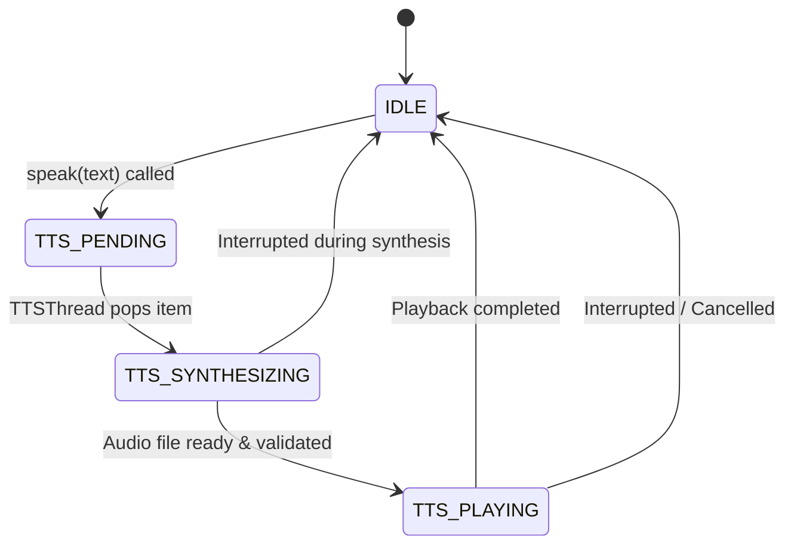
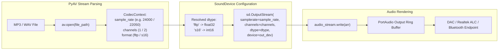

# JARVIS TTS Playback: Synthesis Through Physical Audio Output

## 1. Subsystem Architecture

The TTS Playback subsystem bridges textual responses from JARVIS cognitive layers to physical soundwaves produced by the audio hardware. It incorporates a FIFO worker queue, a SHA-256 disk cache, multi-provider tiering (Cloud Neural EdgeTTS, Windows SAPI COM, pyttsx3, gTTS), PyAV container decoding, and SoundDevice PortAudio output streaming.

---

## 2. TTS Playback Dataflow & State Machine

```mermaid
graph TD
    subgraph Request_Phase ["1. Request & Enqueue Phase"]
        REQ["speak(text, interrupt=True)<br/>[core/tts/tts_manager.py:L153]"]
        INT_CHK{"interrupt == True and<br/>(is_speaking() or not queue.empty())"}
        FLUSH["self.interrupt(force=True)<br/>Set _interrupt_event, stop stream, clear queue"]
        Q_PUT["self._queue.put(('text', text, t0, t1))"]
    end

    subgraph Worker_Phase ["2. TTSThread Worker Processing"]
        POP["item = self._queue.get()<br/>State -> TTS_SYNTHESIZING"]
        SIG_SYNTH["_trigger_callback(on_start_synthesizing_cb)<br/>Runtime muting active"]
        CACHE_CHK{"_check_cache(text)<br/>logs/tts_cache/tts_hash.ext"}
        SYNTH_PRIM["Primary Provider: EdgeTTS<br/>EdgeTTSProvider.synthesize_to_file()"]
        FB_CHK{"Synthesis Succeeded?"}
        FALLBACK["Fallback Tier:<br/>1. WindowsSAPIProvider (SpFileStream)<br/>2. Pyttsx3Provider<br/>3. GTTSProvider"]
        SAVE_CACHE["_save_to_cache(source_path, text)"]
    end

    subgraph Validation_Phase ["3. File & Device Validation Phase"]
        FILE_VAL{"os.path.exists(path) and<br/>os.path.getsize(path) > 0"}
        DEV_RES["_resolve_output_device()<br/>Query sd.query_devices()"]
    end

    subgraph Playback_Phase ["4. Hardware Playback Phase"]
        AV_OPEN["container = av.open(file_path)<br/>stream = container.streams.audio[0]"]
        FMT_RES["Format Resolution:<br/>sample_rate, channels, codec<br/>dtype: float32 / int16 / uint8"]
        SD_OPEN["audio_stream = sd.OutputStream(<br/>samplerate, channels, dtype, device=out_dev)"]
        SD_START["audio_stream.start()<br/>State -> TTS_PLAYING"]
        SIG_SPEAK["_trigger_callback(on_start_speaking_cb)"]
        STREAM_LOOP["for frame in container.decode(stream):<br/>arr = frame.to_ndarray()<br/>audio_stream.write(arr)"]
        CANCEL_CHK{"_interrupt_event.is_set()?"}
        BREAK_CANCEL["break (playback cancelled)"]
        SD_STOP["audio_stream.stop()<br/>audio_stream.close()"]
        FALLBACK_WINSOUND["Winsound Fallback:<br/>winsound.PlaySound(file_path)"]
    end

    subgraph Teardown_Phase ["5. Teardown & Duplex Release"]
        DEL_TMP["_delete_file_safely(temp_file)"]
        SIG_STOP["_trigger_callback(on_stop_speaking_cb)<br/>Runtime set_speaking_active(False)"]
        DONE["_queue.task_done()<br/>State -> IDLE"]
    end

    REQ --> INT_CHK
    INT_CHK -->|True| FLUSH
    INT_CHK -->|False| Q_PUT
    FLUSH --> Q_PUT
    Q_PUT --> POP
    POP --> SIG_SYNTH
    SIG_SYNTH --> CACHE_CHK
    CACHE_CHK -->|Cache Hit| FILE_VAL
    CACHE_CHK -->|Cache Miss| SYNTH_PRIM
    SYNTH_PRIM --> FB_CHK
    FB_CHK -->|Success| SAVE_CACHE
    FB_CHK -->|Failed / Timeout| FALLBACK
    FALLBACK --> SAVE_CACHE
    SAVE_CACHE --> FILE_VAL

    FILE_VAL -->|Valid| DEV_RES
    FILE_VAL -->|Invalid / Missing| DONE
    DEV_RES --> AV_OPEN
    AV_OPEN --> FMT_RES
    FMT_RES --> SD_OPEN
    SD_OPEN --> SD_START
    SD_START --> SIG_SPEAK
    SIG_SPEAK --> STREAM_LOOP
    STREAM_LOOP --> CANCEL_CHK
    CANCEL_CHK -->|True| BREAK_CANCEL
    CANCEL_CHK -->|False| STREAM_LOOP
    STREAM_LOOP -->|Loop Finished| SD_STOP
    BREAK_CANCEL --> SD_STOP
    SD_OPEN -.->|PyAV/PortAudio Exception| FALLBACK_WINSOUND
    FALLBACK_WINSOUND --> DEL_TMP
    SD_STOP --> DEL_TMP
    DEL_TMP --> SIG_STOP
    SIG_STOP --> DONE
```

---

## 3. Provider Detailed Analysis

| Provider Key | Class & Module | Synthesis Mechanism | Output Format | Avg Latency | Network Needed |
|---|---|---|---|---|---|
| **`edge` (Default)** | `EdgeTTSProvider` `core/tts/providers/edge_tts_provider.py` | Asynchronous cloud WebSocket using Microsoft Edge Neural TTS | MP3 (24kHz Mono, `mp3float`, `fltp`) | 300ms - 900ms (timeout at 2500ms) | Yes |
| **`sapi` / `windows`** | `WindowsSAPIProvider` `core/tts/providers/windows_sapi_provider.py` | Win32 COM `SAPI.SpVoice` writing to `SAPI.SpFileStream` | WAV (22.05kHz Mono, `pcm_s16le`, `s16`) | 20ms - 60ms | No (100% Offline) |
| **`pyttsx3`** | `Pyttsx3Provider` `core/tts/providers/pyttsx3_provider.py` | SAPI5 / eSpeak wrapper saving to temporary WAV | WAV (22.05kHz Mono, `pcm_s16le`, `s16`) | 80ms - 150ms | No (100% Offline) |
| **`gtts`** | `GTTSProvider` `core/tts/providers/gtts_provider.py` | Google Translate TTS REST API saving to MP3 | MP3 (24kHz Mono, `mp3float`, `fltp`) | 800ms - 2000ms | Yes |

---

## 4. Hardware Audio Format & SoundDevice Streaming

---

## 5. Identified Sound Failure Vulnerabilities (Pre-Fix Audit)

1. **Self-Interruption / Acoustic Feedback Loop [CRITICAL]**:
   - `SpeechListener._audio_callback` did not check `self.speaking_active`.
   - Audio playing from the laptop speakers triggered VAD (`rms > speech_threshold`).
   - The microphone recorded the spoken output for 5.0 seconds, transcribed it, and called `ResponseManager.handle_response(...)`.
   - `TTSManager.speak(..., interrupt=True)` was triggered, which executed `self.interrupt(force=True)`.
   - Active playback was instantly stopped with `[TTS-DEBUG] playback cancelled: Interrupted during streaming`.

2. **Premature Stream Stop on Short Audio [HIGH]**:
   - `audio_stream.write(arr)` is asynchronous relative to physical speaker output.
   - For short words (e.g. "Done.", "Muted."), PortAudio accepted all chunks in ~10ms.
   - The loop exited immediately and called `audio_stream.stop()`, truncating the hardware buffer before physical sound was emitted.

3. **Hardcoded Device Selection Lockout [MEDIUM]**:
   - `_resolve_output_device()` queried `sd.default.device[1]` and locked playback to device 3 (`Speaker (Realtek(R) Audio)` on MME hostapi 0).
   - If the user was using headphones or Bluetooth earbuds (`Noise Buds N1 Pro`, `Airdopes 131 Elite ANC`), audio was routed exclusively to the internal speakers instead of the user's active listening device.
