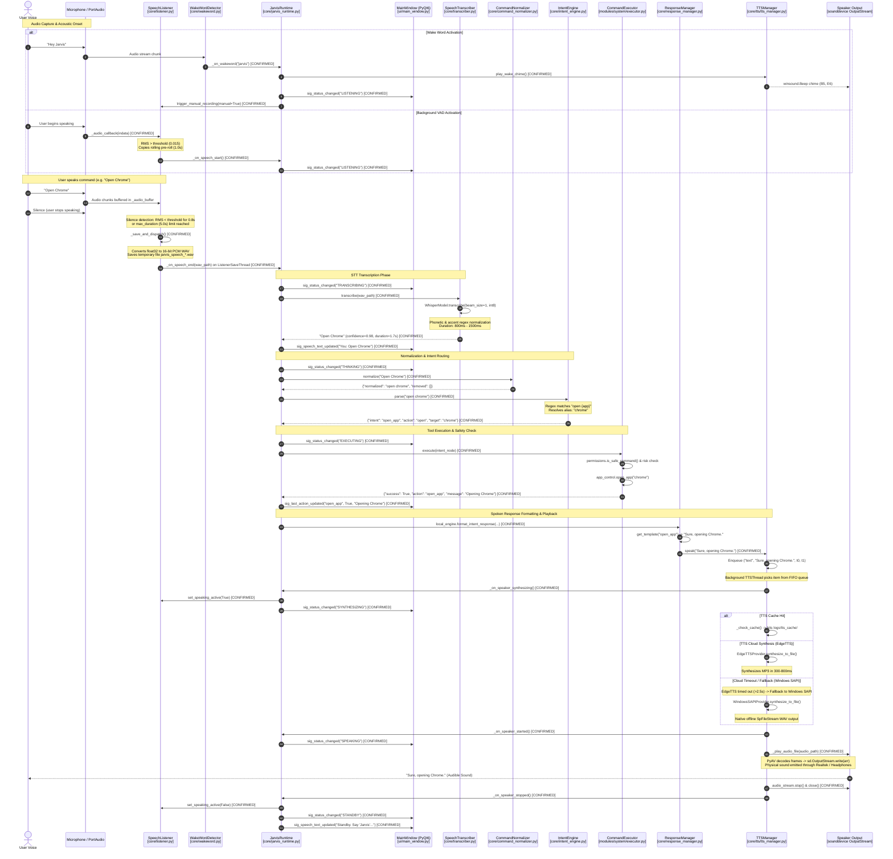

# JARVIS Voice Command Execution Sequence

## 1. Overview & Pipeline Lifecycle

This sequence diagram illustrates the complete chronological path of a voice command from acoustic vibration at the microphone to spoken audio response through the sound card.

- **Confirmed [CONFIRMED]**: Verified by code inspection and runtime log tracing.
- **Inferred [INFERRED]**: Timing approximations and edge-case execution paths.

---

## 2. End-to-End Sequence Diagram

---

## 3. Thread Concurrency & Execution Contexts

| Stage | Execution Thread | Blocking Nature | Thread Safety Mechanism |
|---|---|---|---|
| **Audio Capture** | PortAudio C-thread / `_audio_callback` | Non-blocking realtime | `self._lock` inside `SpeechListener` |
| **WAV File Serialization** | `ListenerSaveThread` (Daemon) | Short disk write (~10ms) | Independent temporary file name |
| **Whisper STT** | `ListenerSaveThread` (Daemon) | Blocking CPU inference (0.8s-1.5s) | CTranslate2 multithreading (`cpu_threads=4`) |
| **Command & Intent Routing** | `ListenerSaveThread` (Daemon) | Fast synchronous (<5ms) | Read-only regex and dict lookups |
| **Command Execution** | `ListenerSaveThread` (Daemon) | OS subprocess / API call | Thread-isolated |
| **TTS Synthesis & Output** | `TTSThread` (Daemon) | Blocking synthesis & audio streaming | `queue.Queue` FIFO + `_interrupt_event` |
| **UI Updates** | Main GUI Thread (PyQt6) | Asynchronous via Qt Signals | `pyqtSignal` cross-thread slots |
