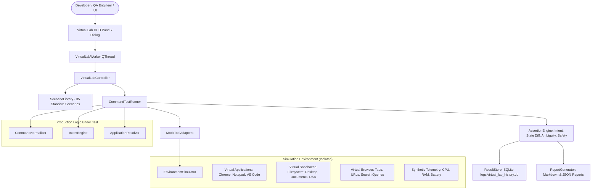

# SANTRA VIRTUAL TESTING ROOM — COMPLETE ARCHITECTURE & USER GUIDE

## 1. Subsystem Architecture Overview

The **SANTRA Virtual Testing Room** is an isolated, deterministic desktop simulation, capability evaluation, and stress-testing lab embedded directly into the native Python + PyQt6 Santra assistant architecture.

Rather than running commands against the user's real Windows desktop, active documents, or consuming live external paid API credits during tests, the lab runs against a high-fidelity **Virtual Computer Environment** while exercising the real production intent engine, normalizer, routing pipeline, tool adapters, and state machines.



---

## 2. Component Taxonomy

The subsystem is implemented under `core/virtual_lab/` and `ui/panels/virtual_lab_panel.py`:

| Component | File Path | Primary Responsibility |
| :--- | :--- | :--- |
| **Data Models** | `core/virtual_lab/models.py` | Defines `ExecutionMode`, `ScenarioCategory`, `FailureCategory`, `TestStatus`, `CommandScenario`, and `ScenarioResult`. |
| **Environment Simulator** | `core/virtual_lab/environment_simulator.py` | In-memory `VirtualApplication`, sandboxed `VirtualFileSystem` using isolated `TemporaryDirectory`, `VirtualBrowser` (tabs, URLs, searches), synthetic `VirtualTelemetry`. |
| **Mock Tool Adapters** | `core/virtual_lab/mock_adapters.py` | Safe interceptors routing side-effects (app control, browser tabs, file creation, screen explainer) to the virtual environment. |
| **Assertion Engine** | `core/virtual_lab/assertion_engine.py` | Multi-dimensional assertion engine verifying parsed intent, executed tool, state mutations, and safety confirmations. |
| **Scenario Library** | `core/virtual_lab/scenario_library.py` | Data-driven library of 35 scenarios covering 10 distinct categories (A through J). |
| **Stress Manager** | `core/virtual_lab/stress_manager.py` | Bounded concurrent workload coordinator with thread limits, timeouts, and cancellation. |
| **Command Test Runner** | `core/virtual_lab/test_runner.py` | Executes single and batch scenarios, capturing execution duration and state snapshots. |
| **Result Store** | `core/virtual_lab/result_store.py` | SQLite run persistence (`logs/virtual_lab_history.db`). |
| **Report Generator** | `core/virtual_lab/report_generator.py` | Exports structured Markdown (`SANTRA_VIRTUAL_LAB_RUN_REPORT.md`) and JSON diagnostic artifacts. |
| **Lab Controller** | `core/virtual_lab/lab_controller.py` | Facade orchestrating all test operations, batch runs, category execution, and re-runs. |
| **HUD Panel & Dialog** | `ui/panels/virtual_lab_panel.py` | Native PyQt6 cyber-themed testing dashboard with live scorecards, progress bar, results table, and failure inspector. |

---

## 3. The 10 Scenario Categories

The Virtual Lab verifies all 10 functional domains specified in the engineering requirements:

1. **Category A — Application Control (`APP`)**: Open, launch, close, and switch window focus without duplicate processes.
2. **Category B — Navigation and Search (`NAV`)**: Direct URL navigation, dedicated website searches (YouTube, HiAnime), general search engine queries, and find-in-page.
3. **Category C — Screen Understanding (`SCR`)**: Explaining active screens, visual code understanding, and error diagnosis routing.
4. **Category D — File Creation and Management (`FIL`)**: Sandboxed file generation, folder alias resolution (`dsa/`), overwrite guards, and directory creation.
5. **Category E — Conversational Context (`CTX`)**: Follow-up searches ("Now search for Minecraft"), reusing open websites, and new tab modifiers.
6. **Category F — Sleep, Wake, and Audio (`SLP`)**: Transitioning between `ACTIVE` and `SLEEPING` states, wake word trailing commands, and voice mute.
7. **Category G — AI Provider and Cache Behavior (`AI`)**: Concepts explanations, multi-layer semantic caching verification, and explicit provider prefixes (`gemini: ...`).
8. **Category H — General Knowledge and Reasoning (`RSN`)**: Algorithm walkthroughs (quicksort), programming comparisons (list vs tuple).
9. **Category I — Ambiguity and Adversarial Testing (`AMB`)**: Ambiguous deictic pronouns without antecedents ("Open it", "Search there"), prompt injection resistance, and destructive operation confirmation gates ("Format hard drive C:").
10. **Category J — Stress and Concurrency (`STR`)**: Coalesced rapid queries, immediate voice cancellation ("Stop speaking") without thread leaks.

---

## 4. Execution Modes: Simulation vs Controlled Integration

To prevent accidental modifications to the user's desktop, files, or production accounts:

- **Simulation Mode (`ExecutionMode.SIMULATION`) — DEFAULT**:
  - Virtual applications running in memory.
  - Temporary isolated filesystem tree in `AppData/Local/Temp`.
  - Virtual browser managing tabs and navigation in-memory.
  - Outbound external API calls mocked deterministically.
- **Controlled Integration Mode (`ExecutionMode.CONTROLLED_INTEGRATION`) — OPTIONAL**:
  - Explicitly disabled by default.
  - Restricted to reversable real system integrations only when chosen by the user.

---

## 5. PyQt6 HUD Dashboard & Hotkeys

The Virtual Testing Room is accessible directly within the Santra HUD interface:

- **Hotkey**: Press `Ctrl+Shift+L` anywhere in the Santra window.
- **Button**: Click the `🧪 LAB` button located on the bottom command dock next to `⚙️ AI`.
- **Voice / Command Line**: Type `"open virtual testing room"` or `"virtual lab"` into the command input.
- **Tray Menu**: Right-click the Santra system tray icon and select `🧪 Virtual Testing Room`.
- **Quick Actions**: Click `🧪 Virtual Testing Lab` in the registered quick actions panel.

---

## 6. Running Tests from the Command Line

Developers can run regression tests or batch scenario execution using standard Python `unittest`:

```bash
# Run all virtual lab unit tests
python -m unittest tests/test_virtual_lab.py

# Run all 8 regression suites across Santra
python -m unittest tests/test_santra_identity_and_wakeword.py tests/test_smart_sleep_mode.py tests/test_screen_understanding.py tests/test_file_creation_and_memory.py tests/test_multi_provider_ai.py tests/test_nemotron_intelligent_caching.py tests/test_universal_desktop_interaction.py tests/test_virtual_lab.py

# Run a programmatic full virtual lab sweep and write report
python -c "from core.virtual_lab.lab_controller import VirtualLabController; ctrl = VirtualLabController(); res, md, j = ctrl.run_all(); print(f'Passed: {sum(1 for r in res if r.status.value == \"passed\")}/{len(res)}')"
```
